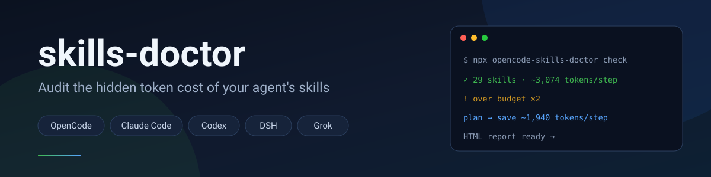
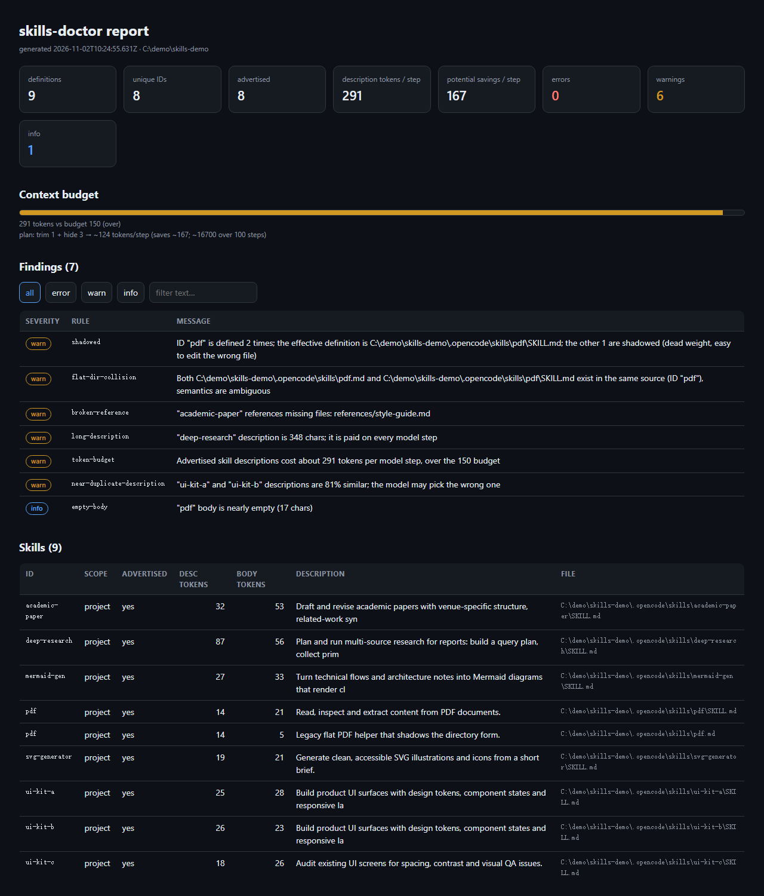
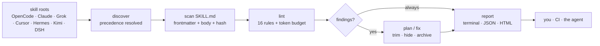

<p align="center">
  
</p>

<h1 align="center">skills-doctor</h1>

<p align="center">
  <b>Audit the token cost your coding agent pays for skills on every step.</b><br>
  A word-piece estimate, boilerplate-aware overlap, and a plan that keeps the routing sentence and hides the redundant skill first.
</p>

<p align="center">
  <a href="https://www.npmjs.com/package/opencode-skills-doctor"></a>
  <a href="https://www.npmjs.com/package/opencode-skills-doctor"></a>
  <a href="https://github.com/wangyuchen5110/opencodeplugginprogram/stargazers"></a>
  <a href="https://github.com/wangyuchen5110/opencodeplugginprogram/actions/workflows/test.yml"></a>
  <a href="https://github.com/marketplace/actions/skills-doctor"></a>
</p>

<p align="center">
  
  
  
  
  <a href="LICENSE"></a>
</p>

<p align="center">
  English · <a href="docs/README.zh-CN.md">简体中文</a> · <a href="CHANGELOG.md">Changelog</a> · <a href="SECURITY.md">Security</a> · <a href="docs/REFERENCE.md">Full reference</a>
</p>

> **Runs 100% locally.** No telemetry, no account, no uploads — your skills,
> prompts and files never leave your machine. See [Privacy](#privacy-local-only-no-data-collection).

## Contents

- [The 30-second version](#the-30-second-version) · [Privacy](#privacy-local-only-no-data-collection)
- [See it](#see-it) · [How it works](#how-it-works) · [Quick start](#quick-start)
- [Install](#install) · [Use it in CI](#use-it-in-ci-github-action) · [Commands](#commands) · [Works where you work](#works-where-you-work)
- [Why it is safe](#why-it-is-safe) · [Development](#development)

## The 30-second version

Every agent skill with a `description` is advertised to the model on **every single step**. On a machine with 29 skills that is **~3,074 tokens per step** — before the model reads a line of your code. Duplicates silently shadow each other, descriptions drift, and references to files that no longer exist go unnoticed.

`skills-doctor` measures that cost, shows which definition actually wins, and fixes it:

| | |
|---|---|
| **Find** | token budget, shadowed duplicates, flat/dir collisions, long descriptions, oversized bodies, broken references, invalid frontmatter, stale skills |
| **Fix** | archive shadowed definitions (reversible), hide redundant skills before unique ones, keep the routing sentence in the plan |
| **Update** | sync skills from HTTP catalogs with a lockfile, drift detection and `--prune` |
| **Report** | terminal, JSON, or a self-contained HTML report |
| **Run it** | CLI · OpenCode plugin (1.x/2.x/Desktop) · MCP server · DeepSeek Harness skill |

## Privacy: local-only, no data collection

`skills-doctor` runs entirely on your machine. There is no telemetry, no analytics, no account, no API key, and nothing is uploaded — not your skills, prompts, conversations or files.

| | |
|---|---|
| **Reads** | only skill definitions (`SKILL.md` plus the `references/`, `scripts/`, `assets/` files they point at), agent config (`opencode.json(c)`, `.skills-doctor.json`, DSH patch, MCP configs) and the lockfile |
| **Never reads** | conversation history, session transcripts, source code, documents, credentials, API keys or environment secrets |
| **Uploads** | nothing: there is no server component and no remote endpoint besides the two optional calls below |
| **Network** | only when you ask for it. `update` fetches the HTTP catalogs **you** configure; `upgrade` / the daily update check reads the npm registry for the latest version number (cached 24 h — disable with `"checkUpdates": "off"`, `SKILLS_DOCTOR_UPDATE_CHECK=0` or `--no-update-check`) |
| **Writes** | only what you asked for: the HTML/JSON report, `.skills-doctor-archive/`, `.skills-doctor.json`, the lockfile, and the plugin/MCP/skill entries created by `install` |

`opencode.json(c)` and MCP configs can contain credentials; they are parsed locally only to find the relevant entries, and those values are never sent anywhere nor included in a report. Reports contain file paths and skill descriptions (which are part of your skill files), never file bodies. `check`, `plan`, `scan`, `fix --dry-run` and `mcp` all work with the network fully offline.

## See it

<p align="center">
  
</p>

A real `check --html` run: summary cards, the context-budget bar, filterable findings, and the exact potential savings.

## How it works



Everything runs in one pass and is deterministic: the same skill files produce the
same numbers, so a report is safe to diff in CI.

## Quick start

```powershell
# terminal report
npx -y opencode-skills-doctor check

# how many tokens can I actually cut?
npx -y opencode-skills-doctor plan

# shareable HTML report
npx -y opencode-skills-doctor check --html report.html --open
```

Example `plan` output on a real setup:

```text
current: ~3,124 tokens/step (30 advertised)   budget: 1,200

Option A — trim descriptions   26 skills → 1,606  (−1,518)
Option B — hide skills         11 skills → 1,200  (−1,924)
Recommended                     trim 26 + hide 2 → 1,184  (−1,940)
over 100 steps that saves ~194,000 tokens
```

## Install

```powershell
# OpenCode — plugin + /skills-doctor, /skills-report, /skills-upgrade commands
npx -y opencode-skills-doctor install              # auto-detects 1.x / 2.x / Desktop
npx -y opencode-skills-doctor install --client desktop

# DeepSeek Harness — MCP tool + audit skill, one command
npx -y opencode-skills-doctor install --client dsh
```

**Claude Code, Codex, Grok or any MCP client** — register the server once:

```powershell
npx -y opencode-skills-doctor mcp
```

```json
{ "mcpServers": { "skills-doctor": { "command": "npx", "args": ["-y", "opencode-skills-doctor", "mcp"] } } }
```

Nothing to configure for **skills discovery**: it reads `.opencode/skills`, `.claude/skills`, `.agents/skills`, `.grok/skills`, `.cursor/skills`, `.hermes/skills`, `.kimi-code/skills`, `.dsh/skills` (plus `$DSH_HOME`) and their user-level equivalents. See the [full reference](docs/REFERENCE.md) for OpenCode 1.x, DSH YAML, Codex TOML and Claude Code details.

## Use it in CI (GitHub Action)

A composite action ships in this repo: no install step, no runtime dependencies —
it runs the checked-out code directly. It is listed on the
[GitHub Marketplace](https://github.com/marketplace/actions/skills-doctor).

```yaml
name: skills
on: [push, pull_request]

permissions:
  contents: read
  pull-requests: write # only needed for `comment: true`

jobs:
  audit:
    runs-on: ubuntu-latest
    steps:
      - uses: actions/checkout@v4
      - uses: wangyuchen5110/opencodeplugginprogram@v0.9.6
        with:
          budget: "1200"
          fail-on: warn             # error | warn | never
          html: skills-report.html  # written and uploaded as an artifact
          comment: "true"           # post the summary on the PR
```

It writes a summary to the job page, uploads the HTML report, optionally comments
on the pull request, and fails the job according to `fail-on`.

| Input | Default | Purpose |
|---|---|---|
| `root` | `.` | Directory to audit |
| `budget` | `1200` | Description tokens paid per model step |
| `fail-on` | `error` | Fail on `error`, `warn`, or `never` |
| `extra-args` | — | Extra `check` flags, e.g. `--no-global` |
| `html` | — | HTML report path; uploaded as an artifact when set |
| `comment` | `false` | Post/append the summary as a pull request comment |

Outputs: `exit-code`, `error-count`, `warning-count`, `advertised-tokens`.

## Commands

| Command | What it does |
|---|---|
| `check` | audit sources, conflicts, budget and broken references (default) |
| `plan` | savings from keeping the first sentence, then hiding redundant skills first, projected over N steps |
| `scan` | every skill with its source, precedence and cost |
| `fix` | archive shadowed definitions (reversible) or hide low-frequency skills |
| `update` | sync skills from HTTP catalogs, verify hashes, detect drift |
| `install` / `uninstall` | wire into OpenCode (1.x/2.x/Desktop) or DeepSeek Harness |
| `upgrade` | check for / apply a newer skills-doctor itself |
| `mcp` | run as an MCP server |

All commands accept `--json`, `--lang en|zh`, `--budget`, `--root` and `--no-global`. Full flags, rules and configuration live in the [reference](docs/REFERENCE.md).

## Works where you work

| Agent | How |
|---|---|
| **OpenCode 2.x** | `plugins: ["opencode-skills-doctor"]` → tool + commands + budget warning |
| **OpenCode 1.x** | `install` writes the local plugin entry and markdown commands |
| **OpenCode Desktop** | shares the CLI config; `--client desktop` detects the app and its bundled core |
| **DeepSeek Harness** | `install --client dsh` adds the MCP entry and the `skills-doctor-audit` skill; `$DSH_HOME/skills` is scanned |
| **Claude Code / Codex** | MCP server (`npx -y opencode-skills-doctor mcp`) |
| **Grok CLI / Cursor** | their skill roots are scanned natively |
| **Hermes Agent** | MCP entry in `~/.hermes/config.yaml`; `~/.hermes/skills` is scanned |
| **Kimi Code** | `install --client kimi` writes `~/.kimi-code/mcp.json` + the audit skill; or use the native plugin: [kimi-skills-doctor](https://github.com/wangyuchen5110/kimi-skills-doctor) |
| **OpenClaw** | separate wrapper with its own native plugin: [openclaw-skills-doctor](https://github.com/wangyuchen5110/openclaw-skills-doctor) |

## Why it is safe

- `fix` only archives **shadowed** definitions, moving them into `.skills-doctor-archive/<timestamp>/` — reversible, and the effective skill is never touched.
- `plan` is pure math: no LLM calls, no network, no file changes.
- `update` blocks path traversal, writes atomically, verifies sha1 and detects drift.
- It is **not** a sandbox; read [SECURITY.md](SECURITY.md) before pointing it at a real setup.

## Development

```powershell
npm test          # 73 tests (node test/doctor.test.mjs)
npm run bench     # lint timing for 100/500/1000 skills
```

CI runs ubuntu/macos/windows × Node 20/22/24; `prepublishOnly` re-runs the tests. Issues and PRs are welcome — see the [reference](docs/REFERENCE.md).

[Full reference](docs/REFERENCE.md) · [中文 README](docs/README.zh-CN.md) · [Changelog](CHANGELOG.md) · [Security](SECURITY.md)

MIT
